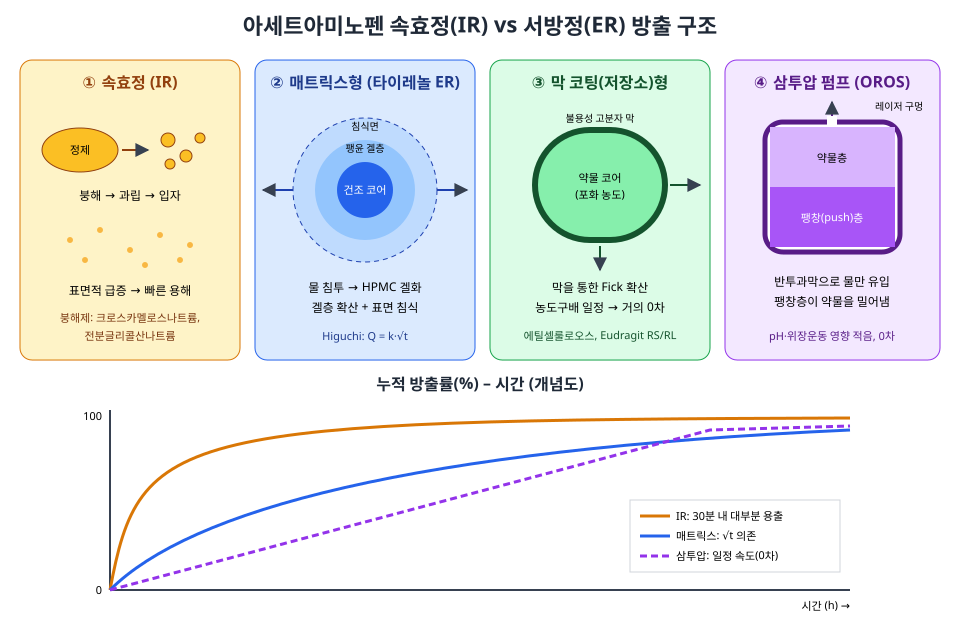
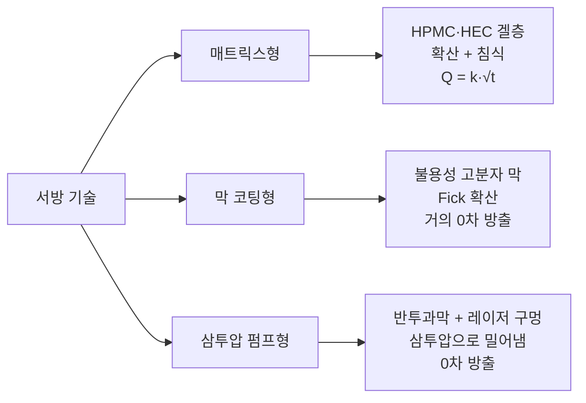
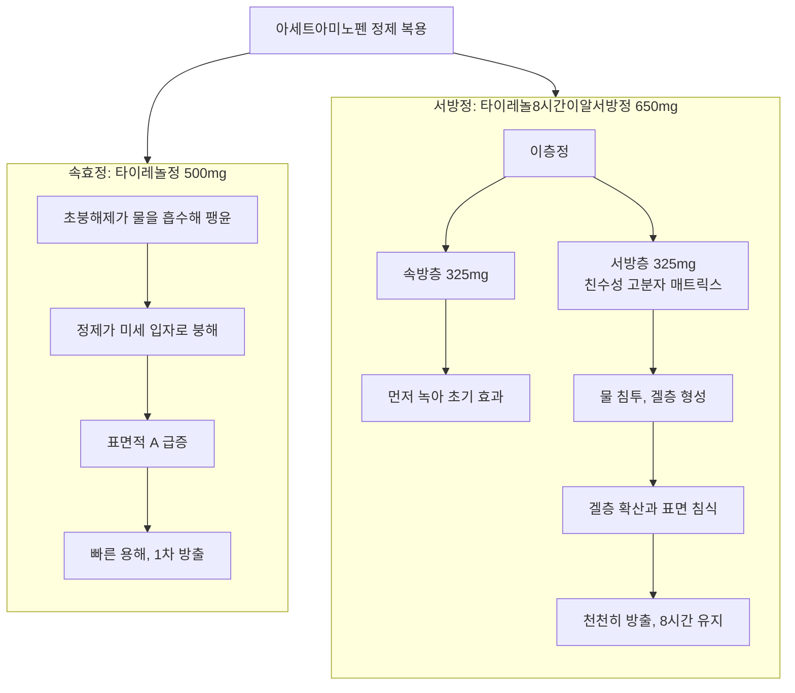
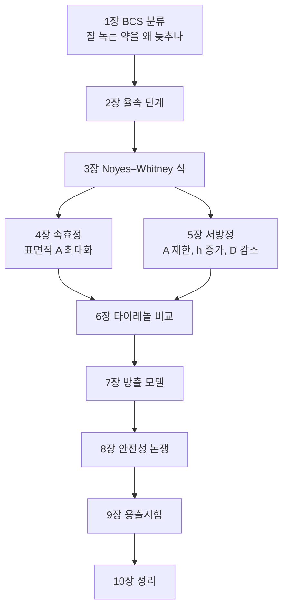

# team7

제형의 비밀: 아세트아밈노펜 속효정과 서방정의 물리화학적 차이


#목차


1.[아세트아미노펜은 어떤 물질인가: 제형 설계의 출발점](#1-아세트아미노펜은-어떤-물질인가-제형-설계의-출발점)


2.[알약이 흡수되기까지: 붕해→ 융해→ 흡수](#2-알약이-흡수되기까지-붕해-융해-흡수)


3.[용해 속도의 법칙: Noyes-Whitney 식](#3-용해-속도의-법칙-NoyesWhitney-식)


4.[속효정의 설계:빨리 부서지게](#4-속효정의-설계-빨리-부서지게)


5.[서방정의 설계:천천히 내보내게](#5-서방정의-설계-천천히-내보내게)


6.[사례분석: 타이레놀정vs타이레놀8시간이알서방정](#6-사례분석)


7.[방출 속도를 수식으로 표현하기](#7.방출-속도를-수식으로-표현하기)


8.[서방형 아세트아미노펜의 안전성 논쟁](#8.서방형-아세트아미노펜의-안전성-논쟁)


9.[제형 검증:용출시험과 f₂ 유사성 인자](#9.제형-검증-용출시험과-f₂-유사성-인자)


10.[정리](#10.정리)

---

**들어가며**
💊제형의 비밀: 아세트아미노펜 속효정과 서방정의 물리화학적 차이
>통합주제: 일상 속 상비약 '아세트아미노펜'의 과학적 탐구와 올바른 복용 가이드 2번파트

1번 파트에서 고체 알약이 물에 녹고 농도 차이로 퍼져나가는 **기본원리**를 다뤘다면, 이 문서는 그 원리로
**"약을 언제, 얼마나 빨리 내보낼지" 설계하는 기술**로 확장한다. 

같은 아세트아미노펜이라도 알약을 어떤 구조로 만들었느냐에 따라 효과가 나타나는 속도와 지속 시간이 달라진다. 

이 문서는 일반 속효정(타이레놀정 500mg)과 서방정(타이레놀8시간이알서방정 650mg)이 **어떤 코딩·내부 구조 차이로 방출 속도를 조절하는지** 논문과 공식 자료를 근거로 분석한다. 

 출처는 문장 끝 []를 활용해서 제시한고, 맨 아래 참고문헌에서 서지 정보와 인용위치를 정리했다.

---


# 1. 아세트아미노펜은 어떤 물질인가: 제형 설계의 출발점

제형을 설계하려면 먼저 약물 자체의 성질을 알아야 한다.

·**생물약제학 분류(BCS)**: 아세트아미노펜은 문헌에 따라 BCS Class I(고용해도·고투과도) 또는 ClassIII(고용해도·저투과도)로 분류되며, 대표 모노그래프는 "ClassIII이지만 Class I 경계"로 평가했다 [1]. 유럽의약품청(EMA) 지침은 아세트아미노펜을 **고용해도 물질이며 흡수율이 85%를 넘는 약물**로 기술한다 [2].   

·**의미**: 원래 잘 녹고 잘 흡수되는 약이므로, 속효정은 "빨리 부서지게만" 하면 충분하다. 반대로 서방정은 이렇게 잘 녹는 약을 억지로 천천히 녹게 만드는 물리적 장치가 필요하다.

# 2. 율속 단계를 설계한다: 붕해 → 용해  →  흡수

경구 고형제는 **녹아서 분자 상태가 되어야만** 위장관 점막을 통과할 수 있다. 용해와 막 투과(확산)의 물리적 원리는 [이후 작성], 여기서는 **제형 설계자가 어느 단계를 조절하는지**에 초점을 맞춘다.


```mermaid
flowchart LR
    A[정제 복용] --> B[붕해<br/>Disintegration]
    B --> C[과립·미세입자]
    C --> D[용해<br/>Dissolution]
    D --> E[소장 점막 흡수]
    E --> F[혈중 농도 상승]

```
# 3. 용해 속도의 법칙: Noyes-Whitney 식
1897년 Noyes와 Whitney는 고체가 녹는 속도가 포화 농도와 현재 농도의 차이에 비례한다는 것을 실험으로 보였다 [3]. 이후 확산층 개념이 더해져 현재는 아래 형태로 쓰인다. 식의 각 항이 제형 설계의 조절 손잡이가 된다는 점이 이 파트의 핵심이다.


$$
\frac{dM}{dt} = \frac{D \cdot A}{h}\,(C_s - C)
$$

| 기호 | 의미 | 제형으로 조절하는 방법 |
|---|---|---|
| D | 확산계수 | 겔층 형성으로 점도↑ → D↓ |
| A | 고체 표면적 | 붕해 여부, 입자 크기 |
| h | 확산층 두께 | 코팅막·겔층 두께 |
| Cs | 포화 용해도 | 염·결정형 선택 |
| C | 매질 내 농도 | 체내에서는 흡수로 낮게 유지 |

속효정 전략: A를 최대화 → 빨리 부서져 표면적을 키운다.


서방정 전략: A를 제한하고, h를 키우거나 D를 낮춘다 → 막이나 겔층으로 확산 경로를 길게 만든다.

# 4.속효정의 설계:빨리 부서지게
-**붕해제**: 크로스카멜로스나트륨(Sodium Carboxymethylcellulose), 전분글리콜산나트륨 (Sodium starch glycolate), 크로스포비돈(Crospovidone) 같은 초붕해제는 팽윤(swelling) 모세관 현상에 의한 물 흡수(wicking), 변형 회복 등의 기전으로 정제를 내부에서 깨뜨린다 [4].


-**필름코팅**: 속효정의 코팅은 쓴맛 차폐 삼킴 편의 습기 차단용의 얇은 수용성 막이며, 방출을 지연시키지 않는다.


-**결과**:표면저 A가 순식간에 커지고, 고용해도인 아세트아미노펜은 빠르게 녹는다. EMA지침도 생동성 시험 면제(biowaiver) 판단 시 **15분 또는 30분 내 85% 이상 용출**을 기준으로 삼는다[2]

# 5.서방정의 설계: 천천히 내보내게




5-1. 친수성 매트릭스형(Matrix)- 타이레놀 ER의 서방층 방식
- 약물을 HPMC·HEC 같은 친수성 고분자 속애 분산시킨다.
- 물이 닿으면 고분자가 팽윤해 겔층을 만들고, 약물은 겔층을 확산해 빠져나오며 바깥 겔은 서서히 침식된다 [5].
- 미국 시판 서방형 아세트아미노펜(TYLENOL8HR)은 속방층+ 침식형(erodible) 서방층으로 구성된다[6]. 관련 특허 문헌은 이 서방층을 하이드록시에틸셀룰로오스(HEC)와 폴리비닐피롤리돈(PVP) 혼합 메트릭스로 기술한다[7].
  

5-2. 막 코팅형 / 저장소형 (Reservoir)
-약물 코어를 물에 녹지 않는 고분자 막(에틸셀룰로오스 등)으로 감싼다.
-코어 안 농도가 포화로 유지되는 동안 막 안팎의 농도 기울기가 일정 → 0차(일정 속도) 방출에 가까워진다.


5-3. 삼투압 펌프형 (OROS)
반투과성 막(물만 통과) 안에 약물을 넣고 레이저로 작은 구멍을 뚫는다. 들어온 물이 만든 삼투압이 약물을 구멍 밖으로 밀어낸다.
이 원리는 Theeuwes의 1975년 기초 삼투압 펌프(elementary osmotic pump) 논문에서 정립되었다 [8].
>📌 장용정은 위산에서는 녹지 않고 장의 높은 pH에서 녹는 코팅으로 방출 시작을 늦추는 지연 방출 제형이다. 오래 천천히 방출하는 서방정과는 목적이 다르다


# 6. 사례 분석: 타이레놀정 vs 타이레놀8시간이알서방정




그림 4. 타이레놀정과 타이레놀8시간이알서방정의 방출 구조 비교 (팀 자체 제작)

| 항목 | 타이레놀정 500mg | 타이레놀8시간이알서방정 650mg |
|---|---|---|
| 방출 형태 | 속효성 | 서방성 |
| 구조 | 단일층 필름코팅정 | **이층정**: 속방층 325mg + 서방층 325mg [9][10] |
| 작동 원리 | 붕해제 → 빠른 붕해·용해 | 속방층이 먼저 녹아 빠른 효과 → 서방층 매트릭스가 천천히 침식·확산 |
| 복용 간격 | 4~6시간 | 8시간 [10] (용량 근거는 [5번 파트](dosage.md)) |
| 분할·분쇄 | 가능 | **불가** (통째로 삼킴) |

- 미국 원개발품(McNeil)과 비교한 생동성 연구에서도, 650mg 서방정이 **속방 325mg + 서방 325mg의 이층 구조**임이 명시되어 있다 [9].
- 국내 동일 계열 제품(펜잘8시간이알서방정)의 허가 성분표에도 1정당 **속방층 325mg, 서방층 325mg**이 따로 기재되어 있다 [10].
- 의미: 앞쪽 속방층이 초기 혈중 농도를 빠르게 올리고, 뒤쪽 서방층이 농도를 유지해 하루 복용 횟수를 줄인다.

※ 복용 용량·간격은 반드시 제품 허가사항과 약사·의사 지시를 따른다.


# 7. 방출 속도를 수식으로 표현하기

| 모델 | 식 | 해석 | 대표 제형 | 출처 |
|---|---|---|---|---|
| 1차 | ln(1 − Q) = −kt | 남은 약물량에 비례 → 점점 느려짐 | 속효정 | [11] |
| 0차 | Q = k·t | 일정 속도 | 삼투압 펌프, 막 코팅 | [8][11] |
| Higuchi | Q = k·√t | 매트릭스 내 확산 지배 | 매트릭스 서방정 | [12] |
| Korsmeyer–Peppas | Q = k·tⁿ | 지수 n으로 기전 구분 | 고분자 매트릭스 | [13][14] |

- **Higuchi 식**: 고체 매트릭스에 분산된 약물의 방출량이 **시간의 제곱근에 비례**함을 이론적으로 유도했다 [12].
- **Korsmeyer–Peppas 식**: n값이 Fick 확산 한계(원통형 정제 약 0.45)에 가까우면 확산 지배, 그보다 크면 고분자 팽윤·침식이 함께 작용하는 비Fick 방출로 해석한다 [13][14].
- **0차 방출이 이상적인 이유**: 혈중 농도가 치료 범위 안에서 평평하게 유지되어 "봉우리(부작용 위험)–골짜기(효과 부족)" 변동이 줄어든다.

  
# 8. 서방형 아세트아미노펜의 안전성 논쟁

서방정은 구조 자체가 방출 속도를 제어하는 장치이므로, **쪼개거나 씹으면 매트릭스가 파괴되어 약물이 한꺼번에 방출(dose dumping)** 될 수 있다. 아세트아미노펜 서방정에는 이와 별개로 **과다복용 시 치료 판단이 어렵다**는 논쟁이 있었다.

- **스웨덴 사례**: 스웨덴 독극물정보센터가 서방형 아세트아미노펜 과다복용 53건을 분석한 결과, 흡수가 지연·연장되어 **기존 속효정 기준 치료 프로토콜이 부족할 수 있음**이 보고되었다 [15].
- **유럽(EMA, 2017)**: 이 분석 등을 근거로 EMA는 서방형 아세트아미노펜 제품의 **EU 시장 판매 중지**를 권고했다 [16].
- **한국(2018)**: 국내에서는 퇴출 대신 과다복용 위험을 줄이는 조치로 **제품명에 '8시간' 삽입, 650mg 제품 포장을 6정 이내로 제한**하는 허가사항 변경이 추진되었다 [17].
- **최근 연구(2025)**: 미국의 속방층+침식형 서방층 구조 제품을 대상으로 한 모델링 연구에서는, 과다복용 시 간독성 지표가 속효정과 **크게 다르지 않게 예측**되었다 [6]. 즉 "서방정"이라도 **내부 구조(매트릭스 종류, 층 구성)에 따라 과다복용 시 거동이 다를 수 있다**는 점이 쟁점이다.

👉 결론: 서방정은 **통째로 삼키고, 정해진 간격(8시간)을 지키며, 다른 아세트아미노펜 함유 약과 중복 복용하지 않는 것**이 핵심이다.

> 🔗 이어서 읽기
> - 흡수된 약이 뇌에서 어떻게 통증·열을 낮추는지 → [3. 진통 및 해열 메커니즘](mechanism.md)
> - 간에서 CYP 효소가 약을 대사하는 경로 → [4. 간 대사와 효소 작용 경로](metabolism.md)
> - 반감기와 하루 최대 용량 4,000mg의 근거 → [5. 약동학 기반 안전 용량](dosage.md)
> - 과다복용·음주 시 NAPQI로 간이 손상되는 기전 → [6. 음주 시 간독성 기전](warnings.md)


# 9. 제형 검증: 용출시험과 f₂ 유사성 인자

설계한 방출 속도가 실제로 구현되는지는 **용출시험**으로 확인한다.

- **조건**: 약전에 규정된 장치(회전검체통법, 패들법)를 쓰며, 시험액 온도는 37 ± 0.5 °C로 체온을 모사한다 [18].
- **pH 조건**: 위~소장 환경을 모사해 pH 1.2, 4.5, 6.8 시험액에서 비교한다 [2].
- **판정**: 속효정은 정해진 시간 내 일정량 이상 용출되어야 하고, 서방정은 초기·중간·말기 여러 시점에서 용출률이 **범위 안**에 있어야 한다. 너무 빨라도(급방출), 너무 느려도(효과 부족) 불합격이다.
- **f₂ 유사성 인자**: 두 제품의 용출 곡선이 비슷한지 판단하는 지표로, **50~100이면 유사**로 본다. Moore와 Flanner가 제안하고 [19], Shah 등이 통계적 특성을 분석했다 [20].

# 10. 정리



*그림 5. 이 문서의 논리 흐름 요약 (팀 자체 제작)*

| 구분 | 속효정 | 서방정 |
|---|---|---|
| 설계 목표 | 빠른 효과 발현 | 지속적·일정한 혈중 농도 |
| Noyes–Whitney 전략 | 표면적 A 최대화 | A 제한, h↑, D↓ |
| 핵심 부형제 | 초붕해제, 수용성 필름 | HPMC·HEC 매트릭스, 에틸셀룰로오스 막 |
| 방출 동역학 | 1차 | Higuchi / 0차 |
| 타이레놀 예 | 타이레놀정 500mg | 속방 325mg + 서방 325mg 이층정 |
| 주의점 | 짧은 간격 복용 | 분쇄·저작 금지, 8시간 간격, 중복 복용 금지 |

**결론**: 아세트아미노펜처럼 원래 잘 녹는 약도, **붕해제·겔 매트릭스·고분자 막·이층 구조** 같은 물리적 설계로 방출 속도를 완전히 바꿀 수 있다. 제형학은 "무엇을 주느냐"만큼 "**어떻게 내보내느냐**"가 약효와 안전성을 좌우한다는 것을 보여준다.

## 참고문헌

> 각 항목의 링크를 누르면 원문(또는 DOI 페이지)으로 바로 이동합니다.

**[1]** Kalantzi L, Reppas C, Dressman JB, et al. Biowaiver monographs for immediate release solid oral dosage forms: Acetaminophen (paracetamol). *J Pharm Sci.* 2006;95(1):4–14. [doi:10.1002/jps.20477](https://doi.org/10.1002/jps.20477)  
↳ 인용 위치: BCS 분류 결론부(Class III, borderline Class I) · 본문 1장 · [Google Scholar 검색](https://scholar.google.com/scholar?q=Biowaiver%20monographs%20for%20immediate%20release%20solid%20oral%20dosage%20forms%3A%20Acetaminophen%20%28paracetamol%29)

**[2]** European Medicines Agency. Paracetamol oral use immediate release formulations product-specific bioequivalence guidance, Rev. 1. [원문 링크](https://www.ema.europa.eu/en/documents/scientific-guideline/paracetamol-oral-use-immediate-release-formulations-product-specific-bioequivalence-guidance-revision-1_en.pdf)  
↳ 인용 위치: 'BCS Classification' 항목 Background(고용해도·흡수율 >85%), 각주(15분/30분 85% 용출) · 본문 1·4·9장

**[3]** Noyes AA, Whitney WR. The rate of solution of solid substances in their own solutions. *J Am Chem Soc.* 1897;19(12):930–934. [doi:10.1021/ja02086a003](https://doi.org/10.1021/ja02086a003)  
↳ 인용 위치: 용해 속도식 원형 · 본문 3장 · [Google Scholar 검색](https://scholar.google.com/scholar?q=The%20rate%20of%20solution%20of%20solid%20substances%20in%20their%20own%20solutions)

**[4]** Desai PM, Liew CV, Heng PWS. Review of disintegrants and the disintegration phenomena. *J Pharm Sci.* 2016;105(9):2545–2555. [doi:10.1016/j.xphs.2015.12.019](https://doi.org/10.1016/j.xphs.2015.12.019)  
↳ 인용 위치: 붕해 기전(swelling, wicking, deformation recovery) 분류 섹션 · 본문 4장 · [Google Scholar 검색](https://scholar.google.com/scholar?q=Review%20of%20disintegrants%20and%20the%20disintegration%20phenomena)

**[5]** Siepmann J, Peppas NA. Modeling of drug release from delivery systems based on hydroxypropyl methylcellulose (HPMC). *Adv Drug Deliv Rev.* 2001;48(2–3):139–157. [doi:10.1016/S0169-409X(01)00112-0](https://doi.org/10.1016/S0169-409X(01)00112-0)  
↳ 인용 위치: HPMC 매트릭스 팽윤·겔층·확산·침식 기전 설명부 · 본문 5-1장 · [Google Scholar 검색](https://scholar.google.com/scholar?q=Modeling%20of%20drug%20release%20from%20delivery%20systems%20based%20on%20hydroxypropyl%20methylcellulose%20%28HPMC%29)

**[6]** Beaudoin JJ, Yang K, Howell BA, et al. Modeling and simulation of acetaminophen pharmacokinetics and hepatic biomarkers after overdoses of extended-release and immediate-release formulations in healthy adults using the QST software platform DILIsym. *CPT Pharmacometrics Syst Pharmacol.* 2025;14(4):681–694. [doi:10.1002/psp4.13304](https://doi.org/10.1002/psp4.13304)  
↳ 인용 위치: Abstract(속방층 + 침식형 서방층, 과다복용 시 유사한 간 지표 예측) · 본문 5-1·8장 · [Google Scholar 검색](https://scholar.google.com/scholar?q=Modeling%20and%20simulation%20of%20acetaminophen%20pharmacokinetics%20and%20hepatic%20biomarkers%20after%20overdoses%20of%20extended-release%20and%20immediate-release%20formulations%20in%20healthy%20adults%20using%20the%20QST%20software%20platform%20DILIsym)

**[7]** 특허 US 2011/0177168 A1, *Composition*. [원문 링크](https://patents.google.com/patent/US20110177168A1)  
↳ 인용 위치: Background(선행기술: 650/667mg 이층정, 속방·서방 동량, HEC+PVP 매트릭스, McNeil Tylenol Extended Relief) · 본문 5-1장

**[8]** Theeuwes F. Elementary osmotic pump. *J Pharm Sci.* 1975;64(12):1987–1991. [doi:10.1002/jps.2600641218](https://doi.org/10.1002/jps.2600641218)  
↳ 인용 위치: 삼투압 펌프 구조 및 0차 방출 이론 · 본문 5-3·7장 · [Google Scholar 검색](https://scholar.google.com/scholar?q=Elementary%20osmotic%20pump)

**[9]** Shep D, Ojha A, Patel S, et al. Bioequivalence and pharmacokinetic evaluation of two formulations of paracetamol ER 650 mg. *Int J Curr Pharm Res.* 2010;2(4). [원문 링크](https://www.troikaa.com/wp-content/uploads/2020/06/224.pdf)  
↳ 인용 위치: Introduction(이층정: 속방 325mg + 서방 325mg, 대조약 McNeil Tylenol ER) · 본문 6장 · [Google Scholar 검색](https://scholar.google.com/scholar?q=Bioequivalence%20and%20pharmacokinetic%20evaluation%20of%20two%20formulations%20of%20paracetamol%20ER%20650%20mg)

**[10]** 식품의약품안전처 의약품안전나라 — 「타이레놀8시간이알서방정」·「펜잘8시간이알서방정」 제품 상세정보. [원문 링크](https://nedrug.mfds.go.kr)  
↳ 인용 위치: 원료약품 및 분량(속방층/서방층 각 325mg), 용법·용량 — 사이트에서 제품명 검색 · 본문 6장  
↳ 확인일: ____-__-__

**[11]** Costa P, Sousa Lobo JM. Modeling and comparison of dissolution profiles. *Eur J Pharm Sci.* 2001;13(2):123–133. [doi:10.1016/S0928-0987(01)00095-1](https://doi.org/10.1016/S0928-0987(01)00095-1)  
↳ 인용 위치: 0차·1차·Higuchi·Korsmeyer–Peppas 모델 정리 섹션 · 본문 7장 · [Google Scholar 검색](https://scholar.google.com/scholar?q=Modeling%20and%20comparison%20of%20dissolution%20profiles)

**[12]** Higuchi T. Mechanism of sustained-action medication. Theoretical analysis of rate of release of solid drugs dispersed in solid matrices. *J Pharm Sci.* 1963;52(12):1145–1149. [doi:10.1002/jps.2600521210](https://doi.org/10.1002/jps.2600521210)  
↳ 인용 위치: 매트릭스 방출식 유도부 (Q = √[D(2A − Cs)Cs·t]) · 본문 7장 · [Google Scholar 검색](https://scholar.google.com/scholar?q=Mechanism%20of%20sustained-action%20medication.%20Theoretical%20analysis%20of%20rate%20of%20release%20of%20solid%20drugs%20dispersed%20in%20solid%20matrices)

**[13]** Korsmeyer RW, Gurny R, Doelker E, Buri P, Peppas NA. Mechanisms of solute release from porous hydrophilic polymers. *Int J Pharm.* 1983;15(1):25–35. [doi:10.1016/0378-5173(83)90064-9](https://doi.org/10.1016/0378-5173(83)90064-9)  
↳ 인용 위치: 멱법칙 Mt/M∞ = k·tⁿ 제시부 · 본문 7장 · [Google Scholar 검색](https://scholar.google.com/scholar?q=Mechanisms%20of%20solute%20release%20from%20porous%20hydrophilic%20polymers)

**[14]** Ritger PL, Peppas NA. A simple equation for description of solute release I. Fickian and non-Fickian release from non-swellable devices in the form of slabs, spheres, cylinders or discs. *J Control Release.* 1987;5(1):23–36. [doi:10.1016/0168-3659(87)90034-4](https://doi.org/10.1016/0168-3659(87)90034-4)  
↳ 인용 위치: 기하 형태별 n값 표(slab 0.5 / cylinder 0.45 / sphere 0.43) · 본문 7장 · [Google Scholar 검색](https://scholar.google.com/scholar?q=A%20simple%20equation%20for%20description%20of%20solute%20release%20I.%20Fickian%20and%20non-Fickian%20release%20from%20non-swellable%20devices%20in%20the%20form%20of%20slabs%2C%20spheres%2C%20cylinders%20or%20discs)

**[15]** Salmonson H, Sjöberg G, Brogren J. The standard treatment protocol for paracetamol poisoning may be inadequate following overdose with modified release formulation: a pharmacokinetic and clinical analysis of 53 cases. *Clin Toxicol (Phila).* 2018;56(1):63–68. [doi:10.1080/15563650.2017.1339887](https://doi.org/10.1080/15563650.2017.1339887)  
↳ 인용 위치: Results·Conclusion(흡수 지연·연장, 표준 프로토콜 불충분) · 본문 8장 · [Google Scholar 검색](https://scholar.google.com/scholar?q=The%20standard%20treatment%20protocol%20for%20paracetamol%20poisoning%20may%20be%20inadequate%20following%20overdose%20with%20modified%20release%20formulation%3A%20a%20pharmacokinetic%20and%20clinical%20analysis%20of%2053%20cases)

**[16]** European Medicines Agency. Modified-release paracetamol-containing products to be suspended from EU market. 2017. [원문 링크](https://www.ema.europa.eu/en/news/modified-release-paracetamol-containing-products-be-suspended-eu-market)  
↳ 인용 위치: 권고 근거 문단(스웨덴 53례 분석) · 본문 8장

**[17]** 김정주. 타이레놀 서방정, 포장단위 축소…제품명에 '8시간'. 데일리팜. 2018-04-10. [원문 링크](https://m.dailypharm.com/user/news/88086)  
↳ 인용 위치: 기사 본문(식약처 허가사항 변경안: 제품명 '8시간', 650mg 6정 이내 포장) · 본문 8장

**[18]** United States Pharmacopeia. General Chapter 〈711〉 Dissolution. / 대한민국약전(KP) 일반시험법 「용출시험법」(조항: ______).  
↳ 인용 위치: 장치(Apparatus 1·2) 및 온도 조건(37 ± 0.5 °C) · 본문 9장

**[19]** Moore JW, Flanner HH. Mathematical comparison of dissolution profiles. *Pharm Technol.* 1996;20(6):64–74.  
↳ 인용 위치: f₁·f₂ 정의식 · 본문 9장 · [Google Scholar 검색](https://scholar.google.com/scholar?q=Mathematical%20comparison%20of%20dissolution%20profiles)

**[20]** Shah VP, Tsong Y, Sathe P, Liu JP. In vitro dissolution profile comparison—statistics and analysis of the similarity factor, f₂. *Pharm Res.* 1998;15(6):889–896. [doi:10.1023/A:1011976615750](https://doi.org/10.1023/A:1011976615750)  
↳ 인용 위치: f₂ 50~100 유사성 기준 및 통계 분석 · 본문 9장 · [Google Scholar 검색](https://scholar.google.com/scholar?q=In%20vitro%20dissolution%20profile%20comparison%E2%80%94statistics%20and%20analysis%20of%20the%20similarity%20factor%2C%20f%E2%82%82)
