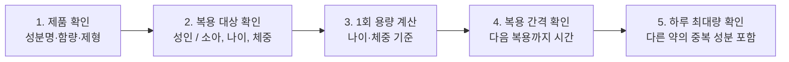
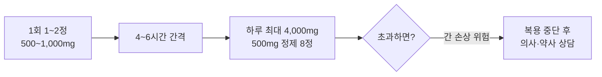

# 연령/체중별 올바른 아세트아미노펜 용량 계산 가이드

## 1. 아세트아미노펜이란?

아세트아미노펜(Acetaminophen, 파라세타몰)은 **열을 내리고(해열) 통증을 줄여주는(진통)** 성분입니다. 약국에서 처방전 없이 살 수 있는 일반의약품에 널리 쓰이며, 두통·치통·생리통·근육통과 감기로 인한 발열에 자주 사용됩니다. 대표적인 제품으로 타이레놀이 있습니다.

| 구분 | 아세트아미노펜 | 이부프로펜 등 NSAIDs |
|------|----------------|----------------------|
| 주요 효과 | 해열, 진통 | 해열, 진통, 소염 |
| 위장 자극 | 비교적 적음 | 상대적으로 있음 |
| 주의할 장기 | **간** (과다 복용 시) | 위, 신장 |

효과가 잘 알려진 안전한 약이지만, **정해진 양을 넘기면 간에 심각한 손상**을 줄 수 있습니다. 
또한 용량이 나이와 체중에 따라 달라지기 때문에 특히 소아는 정확한 계산이 중요합니다. 이것이 이 가이드를 만든 이유입니다.

## 2. 계산 순서 한눈에 보기

용량을 계산하기 전에 아래 5단계를 순서대로 확인합니다.

1. **제품 확인**: 라벨에서 성분이 아세트아미노펜인지, 한 정(또는 한 mL)에 몇 mg이 들어 있는지, 알약·시럽·좌약 중 어떤 제형인지 확인합니다.
2. **복용 대상 확인**: 성인인지 소아인지 구분하고, 소아라면 나이와 **최근에 잰 체중**을 확인합니다.
3. **1회 용량 계산**: 나이·체중 기준으로 한 번에 먹을 양을 구합니다. 시럽은 mg을 mL로 환산해야 합니다.
4. **복용 간격 확인**: 마지막으로 먹은 시각을 기록하고 최소 간격이 지났는지 확인합니다.
5. **하루 최대량 확인**: 오늘 먹은 총량을 합산합니다. 이때 **종합감기약 등 다른 약에 아세트아미노펜이 들어 있는지** 꼭 확인해야 합니다. 중복 복용이 과다 복용의 흔한 원인입니다.

> 처방약이 있는 경우에는 계산 결과보다 **처방전에 적힌 용량**을 따르세요.
> 
> 구체적인 숫자(1회 용량, 간격, 하루 최대량)는 아래 3~4장에서 다루도록 하겠습니다.

## 3. 성인 용량과 하루 최대 복용량

### 3-1. 기본 용량 (타이레놀정 500mg 기준)

국내 허가사항 기준으로, **만 12세 이상 소아와 성인**은 같은 용량을 적용합니다.

| 항목 | 기준 |
|------|------|
| 1회 용량 | 1~2정 (500~1,000mg) |
| 복용 간격 | 4~6시간마다, 필요할 때만 복용 |
| 하루 복용 횟수 | 3~4회 |
| **하루 최대 복용량** | **4,000mg (500mg 정제 기준 8정)** |

### 3-2. 하루 총량 계산하기

하루에 먹을 수 있는 총량은 다음과 같이 계산합니다.

> **하루 총량(mg) = 1회 정수 × 정당 함량(mg) × 복용 횟수**

| 예시 | 계산 | 하루 총량 | 4,000mg 이내? |
|------|------|-----------|----------------|
| 1회 1정, 하루 4회 | 1 × 500 × 4 | 2,000mg | 가능 |
| 1회 2정, 하루 3회 | 2 × 500 × 3 | 3,000mg | 가능 |
| 1회 2정, 하루 4회 | 2 × 500 × 4 | 4,000mg | 가능 (**상한선**) |
| 1회 2정, 하루 5회 | 2 × 500 × 5 | 5,000mg | **초과, 위험** |

1회에 2정을 먹는다면 4시간 간격으로 하루 4번이 상한입니다. 5번째 복용은 하루 최대량을 넘기게 됩니다.

### 3-3. 복용할 때 꼭 지킬 점

- **다른 약 확인**: 종합감기약, 복합 진통제 등에 아세트아미노펜이 함께 들어 있는 경우가 많습니다. 함께 먹으면 모르는 사이에 하루 최대량을 넘길 수 있고, 허가사항에도 아세트아미노펜 복합제와 같이 복용하지 말라는 경고가 포함되어 있습니다.
- **복용 기간 제한**: 의사나 약사의 지시 없이 통증에는 10일 이상, 발열에는 3일 이상 계속 복용하지 않습니다.
- **음주 주의**: 술을 마시는 동안에는 복용을 피합니다. 알코올과 함께하면 간에 부담이 커집니다.
- **서방정(8시간 제품)은 별도 확인**: 650mg 서방정처럼 함량과 복용법이 다른 제품은 위 표를 그대로 적용하지 말고 해당 제품 라벨을 따릅니다.
- **간 질환자·고령자·장기 복용자**: 위 기준이 그대로 적용되지 않을 수 있으니 의사나 약사와 먼저 상담합니다.
- **처방약이 있는 경우**: 처방전에 적힌 용량을 우선합니다.

## 4. 소아 용량 계산 방법

### 4-1. 계산 공식

### 4-2. 연령·체중별 1회 권장 용량표

### 4-3. 복용 간격과 하루 최대 횟수

## 5. 과다 복용의 위험

## 6. 안전하게 복용하는 습관

## 7. 출처
