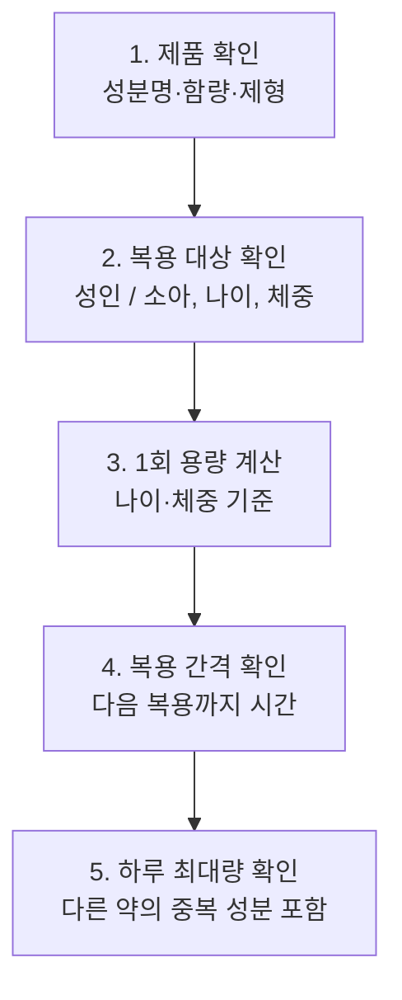

# 연령/체중별 올바른 아세트아미노펜 용량 계산 가이드

## 1. 아세트아미노펜이란?

아세트아미노펜(Acetaminophen, 파라세타몰)은 **열을 내리고(해열) 통증을 줄여주는(진통)** 성분입니다. 약국에서 처방전 없이 살 수 있는 일반의약품에 널리 쓰이며, 두통·치통·생리통·근육통과 감기로 인한 발열에 자주 사용됩니다. 대표적인 제품으로 타이레놀이 있습니다.

| 구분 | 아세트아미노펜 | 이부프로펜 등 NSAIDs |
|------|----------------|----------------------|
| 주요 효과 | 해열, 진통 | 해열, 진통, 소염 |
| 위장 자극 | 비교적 적음 | 상대적으로 있음 |
| 주의할 장기 | **간** (과다 복용 시) | 위, 신장 |

효과가 잘 알려진 안전한 약이지만, **정해진 양을 넘기면 간에 심각한 손상**을 줄 수 있습니다. 
또한 용량이 나이와 체중에 따라 달라지기 때문에 특히 소아는 정확한 계산이 중요합니다. 이것이 이 가이드를 만든 이유입니다.

## 2. 계산 순서 한눈에 보기

용량을 계산하기 전에 아래 5단계를 순서대로 확인합니다.

1. **제품 확인**: 라벨에서 성분이 아세트아미노펜인지, 한 정(또는 한 mL)에 몇 mg이 들어 있는지, 알약·시럽·좌약 중 어떤 제형인지 확인합니다.
2. **복용 대상 확인**: 성인인지 소아인지 구분하고, 소아라면 나이와 **최근에 잰 체중**을 확인합니다.
3. **1회 용량 계산**: 나이·체중 기준으로 한 번에 먹을 양을 구합니다. 시럽은 mg을 mL로 환산해야 합니다.
4. **복용 간격 확인**: 마지막으로 먹은 시각을 기록하고 최소 간격이 지났는지 확인합니다.
5. **하루 최대량 확인**: 오늘 먹은 총량을 합산합니다. 이때 **종합감기약 등 다른 약에 아세트아미노펜이 들어 있는지** 꼭 확인해야 합니다. 중복 복용이 과다 복용의 흔한 원인입니다.

> 처방약이 있는 경우에는 계산 결과보다 **처방전에 적힌 용량**을 따르세요.
> 구체적인 숫자(1회 용량, 간격, 하루 최대량)는 아래 3~4장에서 다루도록 하겠습니다.

## 3. 성인 용량과 하루 최대 복용량

## 4. 소아 용량 계산 방법

### 4-1. 계산 공식

### 4-2. 연령·체중별 1회 권장 용량표

### 4-3. 복용 간격과 하루 최대 횟수

## 5. 과다 복용의 위험

## 6. 안전하게 복용하는 습관

## 7. 출처
