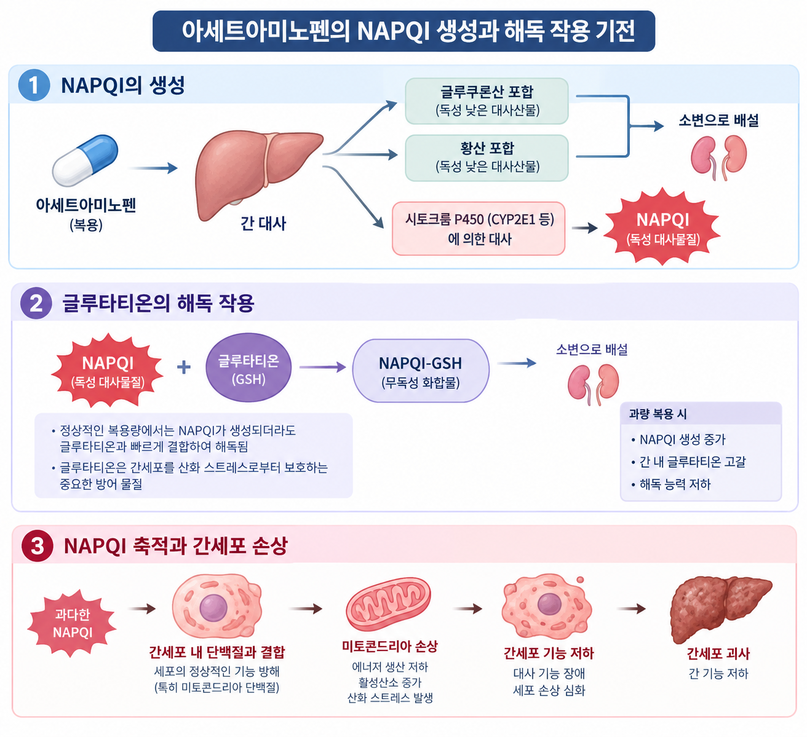

# 금기증 심층 분석: 음주 후 아세트아미노펜 복용 시 간독성의 생화학적 기전

> 약물은 간에서 대사되는 과정에서 독성을 지닌 물질을 생성하기도 합니다. 본 문서에서는 아세트아미노펜의 대사 과정에서 형성되는 NAPQI와 글루타티온의 해독 작용을 살펴보고, 알코올이 이러한 과정에 미치는 영향을 바탕으로 간세포 손상의 원인을 분석합니다.

---

## 목차

1. [아세트아미노펜의 대사 과정](#1-아세트아미노펜의-대사-과정)
2. [NAPQI 생성과 해독 작용](#2-napqi-생성과-해독-작용)
3. [알코올과 간세포 손상](#3-알코올과-간세포-손상)
4. [복용 시 주의사항](#4-복용-시-주의사항)
5. [정리](#5-정리)
6. [참고문헌](#6-참고문헌)

---

## 1. 아세트아미노펜의 대사 과정
아세트아미노펜은 해열 및 진통 작용을 나타내는 약물로, 복용 후 주로 간에서 대사된다. 간은 약물을 체내에서 처리하고 배출할 수 있는 형태로 전환하는 역할을 한다. 아세트아미노펜의 대부분은 글루쿠론산 포합과 황산 포합을 거쳐 독성이 낮은 형태로 바뀐 뒤 소변으로 배설된다.[1]

그러나 일부 아세트아미노펜은 간의 시토크롬 P450(CYP450) 효소에 의해 대사되면서 NAPQI라는 반응성이 높은 독성 대사물질을 생성한다. 정상적인 상황에서는 글루타티온이라는 물질이 NAPQI와 결합해 독성을 줄인다. 하지만 NAPQI가 지나치게 많이 생성되거나 글루타티온이 부족해지면 해독 작용이 충분히 이루어지지 않아 간세포가 손상될 수 있다.[1]

따라서 아세트아미노펜의 간독성을 이해하려면 약물의 대사 과정뿐 아니라 독성 대사물질인 NAPQI의 생성과 이를 제거하는 글루타티온의 작용을 함께 살펴볼 필요가 있다.

## 2. NAPQI 생성과 해독 작용

### 2.1 NAPQI의 생성과 특징

NAPQI(N-acetyl-p-benzoquinone imine)는 아세트아미노펜이 간에서 대사되는 과정에서 생성되는 반응성이 높은 독성 대사물질이다. 정상적인 복용량에서는 아세트아미노펜의 대부분이 글루쿠론산 및 황산과 결합하여 독성이 낮은 물질로 전환된다. 그러나 일부는 시토크롬 P450(CYP450) 효소, 특히 CYP2E1 등에 의해 대사되어 NAPQI를 생성한다.[1, 2]

NAPQI는 반응성이 높기 때문에 체내에 과도하게 축적되면 간세포의 정상적인 기능을 방해할 수 있다. 다만 정상적인 상황에서는 NAPQI가 생성되더라도 간세포에 존재하는 글루타티온과 결합하여 해독된다. 따라서 NAPQI의 생성량과 이를 제거하는 해독 능력 사이의 균형이 중요하다.[2]

### 2.2 글루타티온의 해독 작용

글루타티온(glutathione, GSH)은 세포를 산화 스트레스로부터 보호하는 데 중요한 역할을 하는 물질이다. 간에서는 글루타티온이 NAPQI와 결합하여 독성을 줄이고, 이후 생성된 물질은 체외로 배설될 수 있는 형태로 처리된다. 이러한 과정은 간세포를 보호하는 주요 방어 기전 중 하나이다.[2]

그러나 아세트아미노펜을 과량 복용하면 NAPQI의 생성량이 증가하여 간의 글루타티온이 빠르게 소모될 수 있다. 글루타티온이 부족해지면 NAPQI를 효과적으로 해독하기 어려워진다. 그 결과 해독되지 못한 NAPQI가 간세포 내부의 단백질과 결합하여 세포 기능에 영향을 미칠 수 있다.[2]

### 2.3 NAPQI 축적과 간세포 손상

글루타티온의 해독 능력이 부족해지면 NAPQI는 간세포 내부의 여러 단백질과 결합할 수 있다. 특히 미토콘드리아 단백질이 손상되면 세포의 에너지 생산과 산화 스트레스 조절에 문제가 발생할 수 있다. 이 과정에서 활성산소와 같은 반응성 물질이 증가하면 세포 손상이 더욱 심해질 수 있다.[2]

미토콘드리아의 기능 저하는 간세포의 에너지 대사를 방해한다. 손상이 심해지면 간세포가 괴사할 수 있으며, 손상된 세포가 많아질수록 간 기능에도 영향을 줄 수 있다. 즉, 아세트아미노펜 과량 복용으로 인한 간독성은 NAPQI의 과도한 생성, 글루타티온의 고갈, 세포 단백질 손상, 미토콘드리아 기능 저하가 이어지면서 나타난다.[2]

이처럼 아세트아미노펜의 간독성은 독성 대사물질의 생성뿐 아니라 이를 제거하는 체내 방어 체계의 상태에도 영향을 받는다. 따라서 NAPQI의 생성과 글루타티온의 해독 작용을 함께 살펴보는 것은 간세포 손상 과정을 이해하는 데 중요하다.

### 2.4 NAPQI 생성과 해독 작용의 흐름

아래 그림은 NAPQI의 생성과 글루타티온에 의한 해독, 과도한 NAPQI 축적으로 인한 간세포 손상 과정을 나타낸다.

그림 1. NAPQI 생성과 해독 작용 및 간세포 손상 과정

## 3. 알코올과 간세포 손상

### 3.1 알코올은 약물 대사에 어떤 영향을 미칠까?

아세트아미노펜의 일부는 CYP2E1 효소에 의해 대사되어 독성 물질인 NAPQI를 생성한다. 알코올은 이 과정에 영향을 줄 수 있으며, 음주 양상에 따라 효과가 달라진다.

| 구분 | CYP2E1에 미치는 영향 |
|:---:|---|
| **급성 음주** | 알코올이 효소에 의한 대사를 일시적으로 억제할 수 있음 |
| **만성 음주** | 효소의 활성이 증가할 수 있음 |

> **핵심:** 알코올이 항상 NAPQI 생성을 증가시키는 것은 아니다. 음주 시점과 습관에 따라 약물 대사에 미치는 영향이 달라진다.[2]

### 3.2 간세포는 어떤 과정으로 손상될까?

글루타티온(GSH)은 NAPQI를 해독하여 간세포를 보호한다. 하지만 NAPQI가 과도하게 생성되거나 글루타티온이 부족하면 간세포 손상이 발생할 수 있다.

**간세포 손상의 5단계**

1. **NAPQI 생성**  
   아세트아미노펜 일부가 CYP2E1 등에 의해 대사된다.
2. **글루타티온 소모**  
   글루타티온이 NAPQI를 해독하는 데 사용된다.
3. **독성 물질 축적**  
   해독 능력이 부족하면 NAPQI가 간세포 내부에 축적된다.
4. **세포 기능 저하**  
   NAPQI가 세포 단백질과 결합하고 미토콘드리아 기능을 손상시킨다.
5. **간세포 손상**  
   산화 스트레스가 증가하고, 심한 경우 간세포 괴사로 이어질 수 있다.[2]

### 3.3 간 손상 위험에 영향을 주는 요인

| 요인 | 간 손상과의 관계 |
|---|---|
| **만성적인 과음** | CYP2E1 활성과 간의 대사 환경에 영향을 줄 수 있음 |
| **글루타티온 부족** | NAPQI 해독 능력이 감소할 수 있음 |
| **아세트아미노펜 과량 복용** | NAPQI 생성이 증가하여 해독 능력을 초과할 수 있음 |
| **영양 부족 및 간 질환** | 개인의 해독 능력과 간 손상 위험에 영향을 줄 수 있음 |

### 3.4 복용 시 주의사항

- **용량 확인:** 제품 설명서의 용법과 용량을 지킨다.
- **성분 확인:** 감기약이나 다른 진통제에 같은 성분이 포함되어 있는지 확인한다.
- **전문가 상담:** 만성적으로 술을 많이 마시거나 간 질환이 있다면 의사 또는 약사에게 상담한다.
- **과량 복용 시 대처:** 권장량을 초과했다면 증상이 없더라도 즉시 의료기관에 연락한다.

> **핵심 정리**

> 아세트아미노펜의 간독성은 **NAPQI 생성량과 글루타티온의 해독 능력 사이의 균형**에 영향을 받는다. 알코올은 이 과정에 영향을 줄 수 있지만, 실제 위험은 음주 양상과 복용량, 건강 상태에 따라 달라진다.
## 4. 복용 시 주의사항

아세트아미노펜은 정해진 용법과 용량을 지켜 복용해야 한다. 음주 습관이나 간 건강 상태에 따라 간 손상 위험이 달라질 수 있으므로 다음 사항에 주의해야 한다.

| 주의사항 | 설명 |
|---|---|
| 정해진 용량 준수 | 제품 설명서에 표시된 용법과 용량을 지키고, 권장량을 초과하지 않는다. |
| 중복 복용 주의 | 감기약 등에도 아세트아미노펜이 포함될 수 있으므로 함께 복용하는 약의 성분을 확인한다. |
| 음주 관련 주의 | 술을 자주 많이 마시는 사람은 복용 전 의사나 약사에게 상담한다. |
| 간 질환 및 영양 상태 확인 | 간 질환이 있거나 영양 상태가 좋지 않다면 복용 전 전문가와 상담한다. |
| 과량 복용 시 대처 | 권장량을 초과했다면 증상이 없더라도 즉시 의료기관에 연락해 안내를 받는다. |

음주 여부만으로 간 손상 위험을 단정하기보다는 음주량과 빈도, 약물 복용량, 간 건강 상태 등을 함께 고려해야 한다.

## 5. 정리

## 6. 참고문헌
[1] 정성필, 문정미, 전병조. 「아세트아미노펜 중독의 치료에 대한 최신지견」. *대한임상독성학회지*, 2022, 20(2). [논문 원문(PDF)](https://www.jksct.or.kr/upload/pdf/OSJDBR_2022_v20n2_39.pdf)

[2] Ramachandran, A., and Jaeschke, H. “Mechanisms of acetaminophen hepatotoxicity and their translation to the human pathophysiology.” *Journal of Clinical and Translational Research*, 2017. [논문 원문](https://pmc.ncbi.nlm.nih.gov/articles/PMC5489132/)
